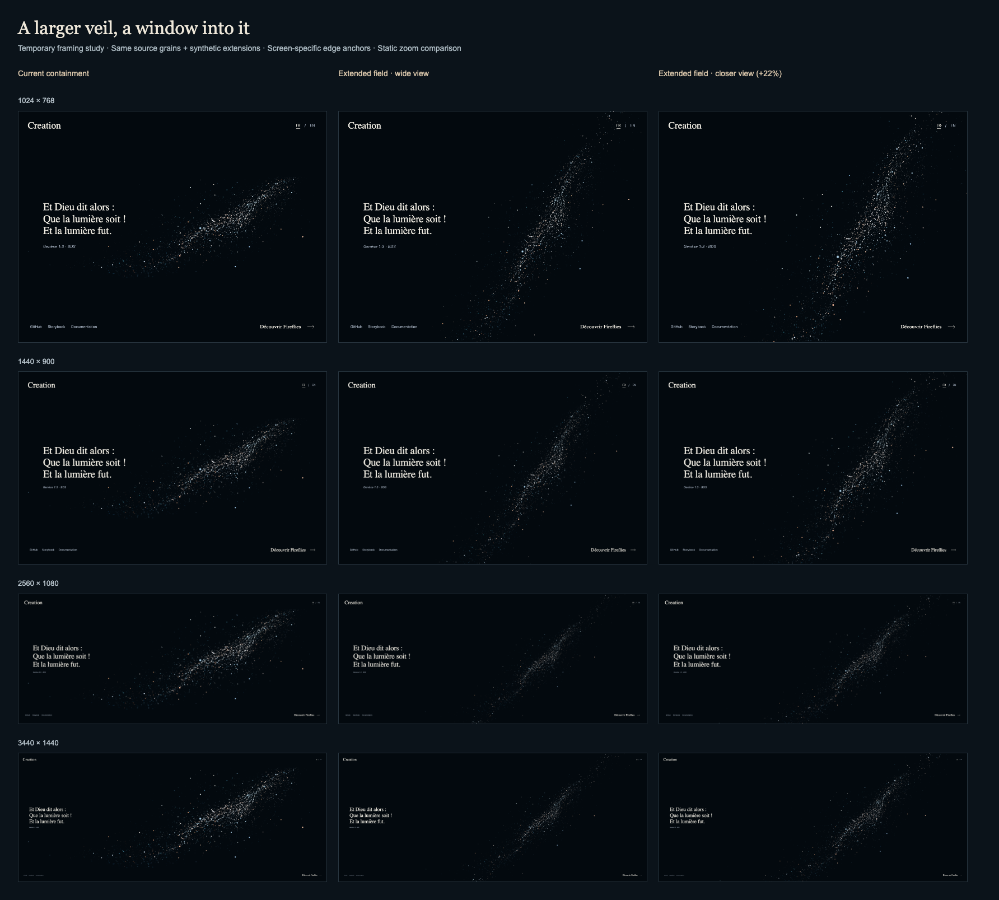

# Extended celestial veil — temporary framing study

This is an exploratory comparison, not production framing or accepted artwork. It tests the owner's
proposal: treat the veil as a larger field and choose a viewport into it rather than contain its
complete reference rectangle. The prepared production asset is unchanged.

Read each row left to right: current containment, extended field at baseline, and the same field at
1.22× zoom. Rows are 1024×768, 1440×900, 2560×1080 and 3440×1440. Each full-resolution PNG is
preserved beside this overview.

| Screen    | Current                        | Extended wide               | Extended closer               |
| --------- | ------------------------------ | --------------------------- | ----------------------------- |
| 1024×768  | [Image](current-1024x768.png)  | [Image](wide-1024x768.png)  | [Image](closer-1024x768.png)  |
| 1440×900  | [Image](current-1440x900.png)  | [Image](wide-1440x900.png)  | [Image](closer-1440x900.png)  |
| 2560×1080 | [Image](current-2560x1080.png) | [Image](wide-2560x1080.png) | [Image](closer-2560x1080.png) |
| 3440×1440 | [Image](current-3440x1440.png) | [Image](wide-3440x1440.png) | [Image](closer-3440x1440.png) |

## Study construction

The 5,674 prepared source grains retain their relative coordinates, depth, color and appearance. For
this study only, 8,000 synthetic grains extend and blend into the two sparse tails. They sample
source-core transverse positions, color, diameter, depth and opacity, with deterministic seed 707.
These are proposed additions, not extra stars detected in reference 07. No reconstructed physical
geometry, measured depth or production density is claimed.

The temporary field occupies a 10,000×6,000 authoring frame. Its anchor is the opacity-weighted
source center (approximately 1045.49, 290.71); its principal axis is about 26.44°. The baseline
camera shows 1,000 world units vertically. Apparent grain size therefore follows viewport height,
avoiding a loss of visual presence on ultrawide/high-resolution screens. The shared diameter
multiplier is 0.85. Orthographic projection and uniform planar transforms keep grains round.

The proposed axis crosses the bottom at 43% of viewport width and the top at 91%; rotation adapts to
aspect ratio, with the center at 67% width. These are directed composition anchors chosen for this
experiment, not an automatic aesthetic detector. The production UI remains visible on the left. The
original renderer is paused in the isolated browser while the experimental renderer draws.

[Measurements](measurements.json) record every view, zoom and counts of grain centers near each
horizontal edge (within 2% viewport height). All eight proposed views have particles on both edges.
That numerical check does not establish a sufficiently dense, luminous or artistically convincing
edge crossing. Inspect the full-size images; thumbnail downscaling hides fine dust.

## Review boundary

Use this comparison to choose composition, dust presence and acceptable crop. The 1×/1.22× interval
is a static example, not the agreed zoom range, input gesture or animation curve. Source
reproduction, halos, local illumination, quiet initial state, parallax and physical perspective are
not changed. A production extension would be authored/generated offline and baked into prepared
data. Runtime framing should use explicit anchors and a bounded zoom policy whose outer limits keep
the tails outside the visible area. Movement and transitions still need separate design and
verification.

Captures use the actual scene/material with software-rendered WebGL2 and the built application UI,
at device pixel ratio 1. They do not validate native WebGPU quality or frame rate. The temporary
runner is retained outside production source; the images and measurements are the review artifacts.
